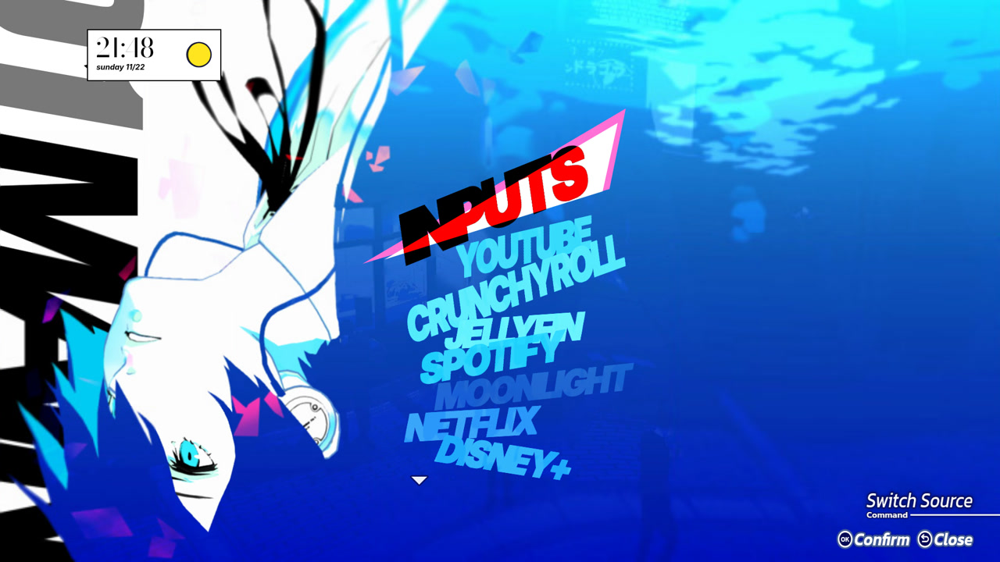
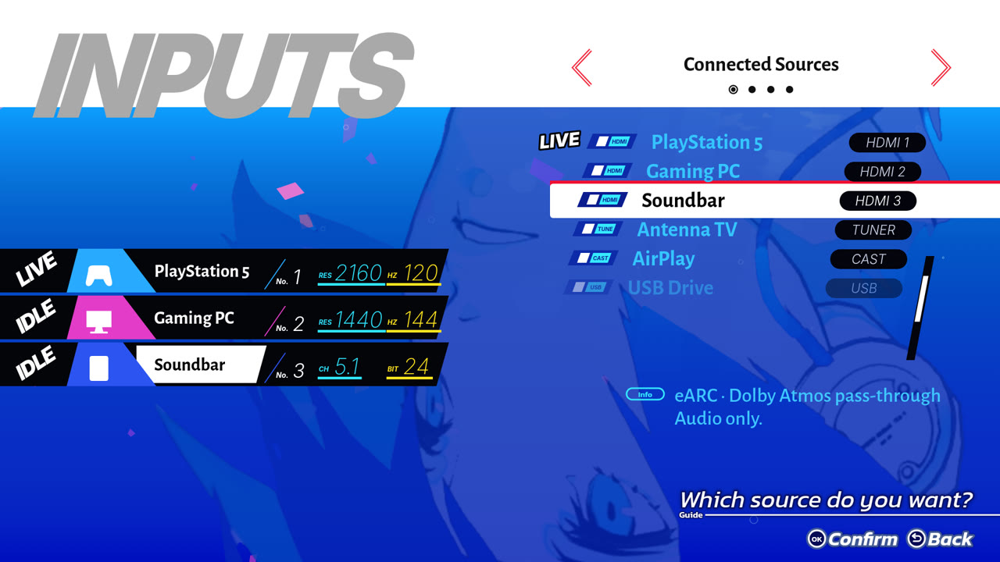

# Main Menu — a home screen for Samsung Tizen TVs

Main Menu opens the apps and inputs on a Samsung Tizen TV in the style of *Persona 3 Reload*.
Main Menu draws the animated Home background at its native 1920×1080 resolution. On the Samsung S90D,
the background advanced one pose per refresh at 60 fps.



| Inputs | Opening an app |
|---|---|
|  |  |

The original launcher, tools, and documentation are licensed under GPLv3. The bundled
game media has separate rights. See [License](#license) and [Artwork and fonts](#artwork-and-fonts).

**Tested on one TV:** a 2024 Samsung S90D (QN55S90D) running Tizen 9.0 (Chromium 120 inside). Everything below was
done on that TV from a Linux computer unless a step says otherwise. It should work on other Samsung TVs with Tizen,
but that is untested — see [What has not been checked](#what-has-not-been-checked).

## What it does

- **Main Menu** starts with INPUTS and a selection of installed apps. Up to eight entries appear at once over the
  scene from 0:19 in the menu recording. The list scrolls and wraps around.
- **OK** on an app opens it. When Main Menu returns to the foreground, the water splash and character descent replay. Returning from Device Care takes you directly to the pending app check.
- **INPUTS** lists what the TV reports as connected (HDMI ports, antenna). OK switches to a source, Back returns.
  (A first attempt — see [What has not been checked](#what-has-not-been-checked).)
- **APPS** is always the last entry. It lists installed apps and lets you choose which ones appear on Main Menu.
  Its seven-row layout follows the Quest screen at 1:13 in the menu recording.
- Home, Inputs and Apps play the recorded cursor, confirmation and Back sounds from the Persona 3 Reload menu footage.
- **Remote**: Up/Down, OK, Back (on the menu, Back puts the app away). Red button: a readout of speed and what the
  TV reported. Green button: step through the four picture levels (the choice is remembered).

Samsung’s startup settings are described in step 6.

## What you need

- A Samsung TV with Tizen, on the same network as your computer.
- A computer with [Tizen Studio](https://developer.tizen.org/development/tizen-studio/download) (free; Windows, macOS
  or Linux). Its command-line tools build and install; its Certificate Manager makes the certificate.
- A free Samsung account, to get a certificate for your TV (step 3).
- The helper scripts use Bash and Python 3. On Windows use WSL or Git Bash.
  The npm commands below wrap the scripts, which can also be run directly.

## 1. Put the TV in Developer Mode

1. On the TV, open **Apps**.
2. Type **12345** with the remote (on a remote without number keys, press the **123** button for an on-screen pad).
3. In the window that appears switch **Developer mode** to **On** and enter the **IP address of your computer**.
4. Restart the TV: hold the power button until it restarts (a short press only puts it to sleep), or unplug it.

"Developer mode" now shows at the top of the Apps screen. Note the TV's own IP address (Settings → Network → Network
Status → IP Settings). Samsung's page on this step:
<https://developer.samsung.com/smarttv/develop/getting-started/using-sdk/tv-device.html>

## 2. Install the Tizen tools

1. Install Tizen Studio. Take the installer "with IDE": it brings the Certificate Manager window used in step 3.
   (The smaller "with CLI" installer has everything for building and installing but, as far as I can tell, not that
   window; it is what I used, together with the helper in [Without a desktop](#without-a-desktop).)
2. In its **Package Manager → Extension SDK**, install **Samsung Certificate Extension**.
   From a terminal: `~/tizen-studio/package-manager/package-manager-cli.bin install cert-add-on`
3. Make `tizen` and `sdb` available, and tell the scripts where the TV is. Copy `tools/local.env.example` to
   `tools/local.env` and adjust it:

   ```sh
   export TV=192.168.1.50                                                    # your TV
   export PATH="$HOME/tizen-studio/tools:$HOME/tizen-studio/tools/ide/bin:$PATH"
   ```

4. Check the connection (the TV has to be switched on — in standby it refuses):

   ```sh
   tools/tv.sh connect      # plain command: sdb connect 192.168.1.50
   tools/tv.sh duid         # plain command: sdb shell 0 getduid     → the TV's device ID, needed in step 3
   ```

## 3. Get a Samsung certificate for your TV

A TV only installs packages signed with a Samsung certificate that names that TV. (With the Tizen tools' own default
certificate my TV answered `install failed[118, -12] Check certificate error : Invalid certificate chain`.)

In Tizen Studio: **Tools → Certificate Manager → +**
1. Give the profile a name — `tv` in the examples below.
2. Choose **Samsung**, device type **TV**.
3. **Author certificate**: create a new one (a name and a password); sign in with your Samsung account when asked.
4. **Distributor certificate**: create a new one, privilege level **Public**, and add your TV's **DUID** (from step 2;
   it is filled in by itself when the TV is connected in Device Manager). Several TVs can be listed.

Samsung's own guide, with pictures:
<https://developer.samsung.com/smarttv/develop/getting-started/setting-up-sdk/creating-certificates.html>

`tizen security-profiles list` should now show the profile. The certificates I was given are valid for one year;
to install after that you will most likely need new ones.

*I made mine without that window, on a computer with no desktop, using the helper in
[Without a desktop](#without-a-desktop). The window is Samsung's documented way and gives the same kind of profile.*

## 4. Build

```sh
npm run package -- tv         # signs build/MainMenu.wgt with the profile named tv
```

This runs `tools/build-tv.sh tv`. To use the same profile each time, set
`TIZEN_PROFILE=tv` in `tools/local.env` and run `npm run package`. Use the profile
that signed your first installation for updates. The script assembles the app in
`dist/` and replaces the previous widget only after checking the app ID, package ID,
and SDK signature files. To run the underlying SDK command by hand:

```sh
mkdir -p dist/assets/menu-sfx dist/fonts build
cp index.html app.js LICENSE NOTICE dist/
cp -R assets/home-frames dist/assets/
cp assets/home-motion.js assets/hero.png assets/home-scene.webp assets/quest-scene.webp assets/quest-idle.webp dist/assets/
cp assets/menu-sfx/*.wav dist/assets/menu-sfx/
cp fonts/* dist/fonts/ && cp tv/config.xml tv/icon.png dist/
cp tv/FONTS.txt dist/fonts/LICENSES.txt
tizen package -t wgt -s tv -o build -- dist          # writes "build/Main Menu.wgt"
```

## 5. Install and start

```sh
npm run tv:install            # tools/tv.sh install
npm run tv:launch             # tools/tv.sh run
```

Installation checks the signed widget against `tv/config.xml`, waits for the SDK's
install result, and confirms the app appears in the TV's installed list. Launch
uses the application ID from that manifest and checks the TV's response.
"Main Menu" is now also in the TV's **Apps** list and opens from there like any app. The first start after an install
is slower than the ones after it.

## 6. Make it the screen the TV starts on

On the TV: **Settings → All Settings → General & Privacy → Start Screen Option** (2022–2024 models; on 2025 models it
is under All Settings → Advanced Features, on 2017–2021 models under Settings → General → Smart Features). Turn
**Autorun Last App** on and **Start with Smart Hub Home** off. The TV then starts with the app that was in front when
it was switched off — so leave Main Menu in front when you turn the TV off. Samsung notes that not every app
supports being started this way; whether this one does on your model is something to try.

## Make it yours

Open **APPS** at the bottom of Main Menu. Use **Up/Down** to select an app and press **OK** to switch between
**Shown** and **Hidden**. Use **Left/Right** to move it earlier or later. Press **Back** to see your changes on
Main Menu. You can also move or hide **INPUTS**. The launcher saves your order and visibility choices automatically.

The list refreshes from the TV when you open Apps and when the launcher returns to the foreground. Installed apps
in the default selection start out shown. Other installed apps start out hidden until you select them. To remove an installed app, hold **OK** on its row (or press the blue button) to see its name and the Device Care instructions.
Press **Settings/123** on the remote to reach Quick Settings. Go to **All Settings → Support → Device Care → Manage Storage**,
select the named app, then choose **Delete** and confirm. Samsung controls which apps offer Delete.
When you return, Main Menu refreshes the installed list. If Settings appeared as an overlay, press **OK** on **Check again**.
[Samsung’s Device Care guide](https://www.samsung.com/ca/support/tv-audio-video/how-to-use-the-device-care-on-my-samsung-smart-tv/)

To customize the default selection, order or command text in code, edit `CATALOG` at the top of `app.js`.

```js
{ key: 'jellyfin', label: 'JELLYFIN', cmd: 'Watch Jellyfin', names: [/^jellyfin/i], ids: ['rTn6ClEurC.Jellyfin'] },
```

- `key` — a unique name used for saved order and visibility. Keep it the same if you rename an app's label.
- `label` — the word in the menu (capitals suit the lettering; long names are set smaller by themselves).
- `cmd` — the sentence shown at the bottom right while the line is selected.
- `ids` — the app's ID on the TV. `tools/tv.sh apps` lists every installed app with its ID.
- `names` — how the TV names the app, used when none of the IDs is found.

Build and install again after editing `app.js`. You can raise `version` in `tv/config.xml` or install over the same
version.

Other things near the top of `app.js`: `VIS` (lines visible at once), `QUALITY` (the four picture levels).

## Updating and removing

- Update: change, `tools/build-tv.sh tv`, `tools/tv.sh install`.
- Remove: delete it on the TV's Apps screen like any other app. (`tools/tv.sh uninstall` should do the same from
  the computer; I have not used it.)

## If something goes wrong

| What you see | Why, and what to do |
|---|---|
| `tools/tv.sh connect`: "the TV does not answer" | The TV is in standby (switch it on), Developer Mode is off, or the address is wrong. |
| `install failed[118, -12] Check certificate error : Invalid certificate chain` | The package was signed with a certificate the TV does not accept: use a **Samsung** profile whose distributor certificate lists this TV's DUID. |
| The SDK fails to sign, or a widget check reports a missing signature | Check the profile name with `tizen security-profiles list` and confirm the SDK can access its certificate passwords (see [Without a desktop](#without-a-desktop)). |
| An installed app is missing from Main Menu | Open **APPS** to refresh the list. Find the app, press **OK** if it says **Hidden**, and press **Back**. |
| The picture is soft / less detailed | A lower picture level is selected. Green button steps through them (2 is the normal one). |
| Two minutes after the last key press the TV shows its screensaver | The TV's own doing (reported for Samsung's OLED models); asking the TV to keep it off had no effect. Any key should bring the menu back. |
| The red-button readout shows well under 60 fps after sitting idle | Same cause: with the TV's screensaver in front, the page loses the graphics chip to it (60 → about 42 frames a second here). The app notices and draws less often until it is in front again. |

## Speed

The renderer shipped in v0.1.0 was measured on the S90D at picture level 2 with the Home background rendered at 1920×1080.
The TV browser sampled every display callback and the pose drawn by the launcher. Four separate captures of
hair, face and water from the TV matched the corresponding original poses.

| Measured action | Frames per second | Missed refreshes | Longest interval |
|---|---:|---:|---:|
| Cold opening, first four seconds of playback | 59.5 | 2 | 33.4 ms |
| Home, 45 seconds after opening | 59.54 | 21 | 300.0 ms |
| Last 30 seconds of that Home run | 60.0 | 0 | About 16.7 ms |
| Independent 30-second Home run | 59.97 | 1 | 33.4 ms |

The full Home run covered all 117 poses. Three display callbacks advanced past the expected next pose.
The splash and transitions can also miss refreshes when the settled background runs at 60 fps.

### How Home draws the animation

The 117 poses from the scene at 0:19 play forward and backward in a 232-frame loop. Every pose has a
240×135 grid of 8×8 source-pixel tiles. Visually similar tiles share an entry in `assets/home-frames/tiles-0.png`,
a 4096×3424 atlas. The matching grid in `poses.png` tells the renderer which tiles make up the current pose.

WebGL draws the portrait and water on their own 1920×1080 canvas beneath the menu. One texture lookup selects
the tile and another reads its pixel at source resolution. For adjacent poses, the renderer keeps the previous
frame and redraws the rectangles in `damage.js`. These cover 19% of the screen on average. A seek redraws
the whole frame. To regenerate the rectangle list from the pose lookup, run `python3 tools/home-damage.py`
with Pillow and NumPy installed. The atlas and lookup together occupy about 68 MiB as RGBA textures. The launcher prepares the textures and rehearses the opening while the screen is white.
With reduced motion enabled, Home shows the still poster. If WebGL is unavailable or loses its context,
Canvas 2D reconstructs the same 1080p poses. An unreadable animation asset also falls back to the poster.

The launcher prepares the menu lettering, clock and other static artwork ahead of time. Bold labels use nine offset
fills. An outlined label took 15–50 ms on its first draw on the S90D. The launcher asks for installed apps
and sources while the screen is white or the menu has settled.

Picture level 2 is the S90D default. Lower levels thin the particles, and level 0 draws the foreground UI at
1280×720. The Home animation keeps its own native canvas. Level 3 adds two motion effects. If Home repeatedly
misses refreshes during use, the launcher drops a level for that session.

On another TV the numbers will differ. The red-button readout shows them live.

## Working on it

Preview on a computer: open `index.html` in a Chromium-based browser. Keys: arrows, Enter, Esc (Back), D (readout),
Q (level). Without a TV the app shows its built-in list and sample sources.

| Address ending | Effect |
|---|---|
| `?q=0` … `?q=3` | fix the picture level |
| `?debug=1` | start with the readout on |
| `?skip=3000` | start 3 seconds in (past the opening) |
| `?script=home` (`all`, `inputs`, `launch`) | play a scripted run of key presses |
| `?demo=9`, `?p3=1` | other menu contents (a nine-line list; the game's own words) |
| `?nogl=1` | draw the opening foam without WebGL |

Tools (Node 22 or newer; `npm install` once):

```sh
npm run check                                   # every screen at several moments + a run against a stand-in for the TV's interfaces
node tools/cap.mjs still home 900,1700,3000     # exact frames as PNGs in out/ (the picture is a pure function of time and keys)
node tools/cap.mjs video launch 6500            # the same as a video (needs ffmpeg)
OLD_CHROMIUM=/path/to/chrome node tools/oldchrome.mjs   # the built package in an older browser engine
```

Measuring on the TV (the app keeps a record of every frame; these read it through the TV's web inspector):

```sh
export CDP=$(tools/tv.sh debug)                 # restarts the app with the inspector on
node tools/tv-inspect.mjs --shot work/tv.png    # the app's own report + a screenshot
node tools/tv-bench.mjs --plan all              # frame pacing while keys are pressed (plans: home, list, all, extra)
node tools/tv-lab.mjs lab/intro.js              # how the first seconds went
node lab/timeline.mjs                           # pacing over time
```

Two things to know before trusting a number from the TV:

- **Measure within two minutes of starting the app.** Key presses sent this way are made up inside the page; the TV
  does not count them as someone using the remote, so its screensaver comes up two minutes after the start and slows
  the page from 60 to about 42 frames a second until a real key is pressed.
- **Restart once after installing.** The first start after an install is slow for reasons that are not the app's.

`lab/` holds the experiments behind the numbers above (cost of single drawing calls, of the TV's own interfaces, of
making a word picture, start-up variants via `?x=` switches).

## Without a desktop

The Tizen tools assume a desktop in two places. `tools/headless/` works around both; it is what I used, on Linux.
It is **not** an official way: it does what Samsung's Certificate Manager does, as read from that program, and can
stop working when Samsung changes theirs.

```sh
export TIZEN_KIT=/somewhere/private            # the helper keeps keys, passwords and its working files here; add it to tools/local.env
export TIZEN_STUDIO=$HOME/tizen-studio         # only if Tizen Studio is not inside $TIZEN_KIT
pip install cryptography
tools/headless/samsung-cert.py check           # prepares its files, says what it found
tools/headless/samsung-cert.py listen &        # waits for the sign-in below
tools/headless/samsung-cert.py url             # open this address in a browser and sign in to your Samsung account
tools/headless/samsung-cert.py request --duid <DUID from tools/tv.sh duid> --name "Main Menu" --profile samsung
rm $TIZEN_KIT/secrets/samsung-token.json       # the sign-in token is no longer needed
tools/build-tv.sh samsung                      # the profile it made is called "samsung"
```

- The sign-in ends by sending the browser to `localhost:4794`, the only address Samsung accepts. If the browser is
  on another computer, tunnel first: `ssh -N -L 4794:localhost:4794 you@the-headless-machine`.
- The build uses the SDK's saved signing profile first. On a headless computer, set
  `PROFILE_PASSWORDS=$TIZEN_KIT/secrets` in `tools/local.env` to let the build restore
  saved password access and retry if the first signing attempt fails.
- `$TIZEN_KIT/secrets` holds your private keys and passwords. Never put it in a repository.

## What is in here

```
index.html, app.js      the app
assets/                 the figure: hero.png (shipped, 1.5× screen size) and hero-full.png (the full cut-out)
fonts/                  the twelve font files the page uses (all SIL Open Font License)
tv/                     what makes it a TV package: config.xml (ID, permissions), icon, font notice
tools/build-tv.sh       assemble + sign            tools/tv.sh        connect, install, start, inspect
tools/*.mjs             previews, checks and TV measurements (see "Working on it")
tools/matte.py          how the figure was cut out of refs/main.jpg
tools/headless/         certificates and signing on a machine without a desktop
lab/                    experiments run on the TV
refs/main.jpg           the game screenshot the figure was cut from
docs/                   the pictures in this file
package.json            the one dependency of the node tools (Playwright)      requirements.txt   what the Python tools need
```

The package asks the TV for four permissions (`tv/config.xml`): starting apps, reading the list of apps, the colour
buttons of the remote, and showing an input behind the page.

## What has not been checked

- Any TV other than the one above; any Tizen version other than 9.0. The page also loads without errors in Chromium
  108 (the generation of Tizen 8). Older TVs have older engines, and the page uses a few newer features (the tight
  letter-spacing of the menu needs Chromium 99).
- Windows and macOS as the building computer.
- The Certificate Manager window of step 3 (I used the helper instead) and `tools/tv.sh uninstall`.
- Opening apps and switching inputs with the real remote have not been gone through systematically: the checks ran
  against a stand-in for the TV's interfaces, and the measurements used made-up key presses with the app start
  stubbed out. INPUTS in particular is a first attempt. Also open: where the TV goes when you leave an app that was
  opened from the menu (back to the menu, or to Samsung's home), and what exactly shows when Back puts the menu away.
- The screensaver was only observed from inside the app (the page loses focus and slows down exactly two minutes
  after the last real key press), not looked at on the screen.
- What happens to the installed app when the certificate runs out.

## License

The Main Menu contributors license their original work under the GNU General Public License, version 3 only
(`GPL-3.0-only`). The same terms cover the launcher, tools, and documentation. Both the source tree and the
TV widget include the [full license](LICENSE) and [third-party notices](NOTICE).

### Artwork and fonts

This is a personal fan project, not connected with or endorsed by ATLUS or SEGA. *Persona 3 Reload* and its artwork
belong to them. `assets/hero*.png` and `refs/main.jpg` come from a screenshot of the game. The Home and Quest
backdrops, animation frames and sounds in `assets/` come from the supplied *Persona 3 Reload – Menus* recording.
Redistribution of the game media requires separate permission from its rights holders.

The bundled Alegreya Sans, Anton, Bodoni Moda, Inter, and Kanit fonts use the SIL Open Font License 1.1.
Their copyright notices and the full font license are in [tv/FONTS.txt](tv/FONTS.txt).
